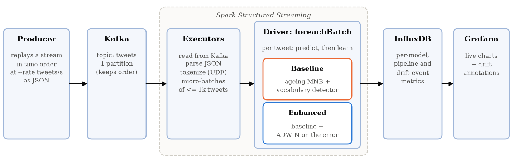

# Drift-Aware Sentiment Stream

Concept drift detection and adaptive learning on a Twitter sentiment stream, end to end on
**Kafka → Spark Structured Streaming → InfluxDB → Grafana**.

We reproduce the *informed ageing Multinomial Naive Bayes* of Iosifidis et al. (an ageing MNB whose
forgetting is tuned by a vocabulary-based change detector) on Sentiment140, and add an **ADWIN
detector on the model's prediction errors**. The vocabulary detector only sees changes in *which
words* are used; ADWIN also sees changes in *what they mean* (real drift with the same vocabulary).

Group 18 · Streaming Data Analysis · report: [`report/report.pdf`](report/report.pdf)



## Results at a glance

From the full experiment grid (7 models × 8 streams, controlled scenarios × 5 seeds, 224 runs).
"Baseline" = the paper's informed ageing MNB (Rebuild-Zero); "enhanced" = the same model + ADWIN
(fusion OR, the main model).

| | Baseline | Enhanced (OR) |
|---|---|---|
| Label flip: accuracy (5 seeds) | 71.0 ± 1.0 % | **73.8 ± 0.3 %** |
| Label flip: detection delay | 3,999 tweets | **39 tweets** |
| Label flip: recovery to 95 % of pre-drift accuracy | 8,204 tweets | **3,183 tweets** |
| Label flip on one topic only: drifts detected | 3 / 5 | **5 / 5** |
| DS1 (Sentiment140) accuracy | 80.8 % | **81.3 %** (AND: 81.7 %) |
| DS1 natural change point: detection delay | 19,224 tweets | **704 tweets** |
| DS2 (volatile variant) accuracy | 83.0 % | **83.7 %** (ADWIN only: 84.1 %) |
| Drifts detected over all 47 / false alarms | 36 / 70 | **39** / 102 |
| Model time in Spark per 1,000 tweets | 22.6 ms | 32.9 ms |

The pipeline sustains about 2,000 tweets/s with sub-second latency (1k-tweet micro-batches) and
about 5,600 tweets/s with 5k-tweet micro-batches. Full tables: [`report/tables/`](report/tables),
figures: [`analysis/figures/`](analysis/figures), takeaways: [`report/inferences.md`](report/inferences.md),
day-by-day log of decisions and findings: [`NOTES.md`](NOTES.md).

## Repository layout

```
core/            models, detectors and metrics (pure Python; shared by every runner)
  preprocess.py    tweet cleaning + tokenizer
  mnb.py           accumulative and ageing MNB (Eq. 1-2, cached normaliser)
  vocab_detector.py, strategies.py, informed.py   the baseline (detector + 5 lambda strategies)
  adwin_detector.py, enhanced.py                  the enhancement (ADWIN + fusion modes)
  factory.py       build any model from a parameter dict
  metrics.py       prequential loop, P/R/F1, detection delay / false alarms / recovery
pipeline/        data builders and the streaming system
  build_ds1.py, build_ds2.py, build_scenarios.py
  producer.py      replay a stream into Kafka
  spark_consumer.py, submit_consumer.sh, influx_sink.py
experiments/     offline runners, configs and results
  runner_offline.py  one model on one stream, prints the full metrics row
  run_config.py      configs/baseline.yaml, configs/enhancement.yaml
  run_sweep.py       detector sensitivity sweep
  run_grid.py        the full grid (configs/grid.yaml)
  streaming_bench.py throughput / latency through Kafka + Spark
  results/           every CSV the report uses
analysis/        figure scripts and figures
grafana/         provisioning + dashboard generator (build_dashboard.py)
docker/spark/    Spark image with the Kafka connector, influxdb-client, numpy, river
report/          IEEE paper (main.tex, refs.bib, tables/, figures/, report.pdf)
tests/           pytest suite (46 tests)
```

## Prerequisites

- **Python 3.12** (tested with 3.12.4) and Git.
- **Docker Desktop** for the streaming system (Kafka, Spark, InfluxDB, Grafana); 8 GB of RAM for
  Docker is comfortable. The offline experiments do not need Docker.
- **Sentiment140**: download `trainingandtestdata.zip` from
  <http://help.sentiment140.com/for-students> (direct link:
  <https://cs.stanford.edu/people/alecmgo/trainingandtestdata.zip>) and put it in `data/raw/`.
  `data/` is not in git; everything in it is rebuilt by the scripts below.

## Setup

```bash
python -m venv .venv          # must be Python 3.12: on Windows use  py -3.12 -m venv .venv
# Git Bash:    source .venv/Scripts/activate      PowerShell:  .\.venv\Scripts\Activate.ps1
# Linux/macOS: source .venv/bin/activate
pip install -r requirements.txt
pytest -q                                   # 46 tests, ~10 s, no data needed
```

## 1. Build the streams

```bash
python pipeline/build_ds1.py          # data/processed/ds1.parquet: Sentiment140 in time order (~15 s)
python pipeline/build_ds2.py          # data/processed/ds2.parquet: volatile variant, 1,073,065 tweets
python pipeline/build_scenarios.py    # data/scenarios/: 6 controlled scenarios x 5 seeds (~20 s)
python analysis/eda_ds1.py            # DS1 class distribution + natural change point
python analysis/plot_streams.py       # sanity plot of every stream
```

Each stream has a `<name>_drift_points.json` with its true drift points.

## 2. Offline experiments (no Docker)

```bash
# one model on one stream; prints accuracy, P/R/F1, detection, recovery and cost
python experiments/runner_offline.py --stream s_label_flip --model enhanced --fusion or \
    --strategy Rebuild --lam 0 --w 4000

python experiments/run_config.py --config experiments/configs/baseline.yaml     # paper reproduction (~20 min)
python experiments/run_config.py --config experiments/configs/enhancement.yaml  # Day 7 comparison
python experiments/run_sweep.py                                                 # ADWIN delta x vocab alpha (~5 min)
python experiments/run_grid.py                                                  # the full grid (~25 min, ~2 GB RAM)

python analysis/plot_baseline.py          # paper-style figures (Fig. 2/3)
python analysis/plot_enhancement.py       # headline label-flip figure
python analysis/make_report_figures.py    # all report figures + tables (CSV and LaTeX)
python analysis/plot_architecture.py
```

Model specs live in the YAML configs; `experiments/results/grid_config.yaml` holds the fully
resolved parameters of every grid cell.

## 3. Streaming system

```bash
cp .env.example .env                 # optional: change credentials (local defaults otherwise)
docker compose up -d --build         # Kafka, Kafka UI, Spark master + worker, InfluxDB, Grafana
bash pipeline/submit_consumer.sh     # Spark consumer: baseline + enhanced side by side (keep it running)
```

In a second terminal:

```bash
python pipeline/producer.py --stream s_label_flip --rate 1000          # the headline scenario
python pipeline/producer.py --stream ds1 --start 1250000 --limit 150000 --rate 2000   # DS1 change point
```

PowerShell: run the same commands on one line each; for the consumer use
`docker exec -it spark-master /opt/spark/bin/spark-submit --master spark://spark-master:7077 --conf spark.driver.host=spark-master --conf spark.executorEnv.PYTHONPATH=/opt/project /opt/project/pipeline/spark_consumer.py`.

| Service | URL |
|---|---|
| Grafana dashboard "Drift Stream" | <http://localhost:3000/d/drift-stream> (admin / password from `.env`) |
| Kafka UI | <http://localhost:8085> |
| Spark master / driver UI | <http://localhost:8090> / <http://localhost:4040> |
| InfluxDB | <http://localhost:8086> |

Pick the run in the dashboard's **Run** menu. Orange is the baseline, blue the enhanced model;
vertical markers are detected drifts (orange: vocabulary detector, blue: ADWIN). Other tools:

```bash
python experiments/streaming_bench.py --rates 500 1000 2000 4000      # throughput / latency per rate
GRAFANA_PASSWORD=... python analysis/grafana_screenshot.py --run <run id> --out shot.png
python grafana/build_dashboard.py                                     # regenerate the dashboard JSON
docker compose stop                                                   # pause the stack (data is kept)
```

Consumer options: `--models baseline enhanced accumulative ...` (presets in
`pipeline/spark_consumer.py`), `--batch-size 5000` for higher throughput.

## Method in brief

- **Ageing MNB** (Eq. 1-2 of Iosifidis et al.): counts are aged on read by
  `exp(-lambda * (t - last seen))`, with `t` in **hours**. The vocabulary normaliser is cached, so
  every update is O(1).
- **Vocabulary detector (baseline)**: precision of the latest window's vocabulary against the
  previous window's, per class, against a moving mean ± 1.8 sd (warning at 0.334 sd); five lambda
  strategies or a rebuild react to it.
- **ADWIN (enhancement)**: ADWIN (delta = 0.01) on the 0/1 prequential error; a rise triggers a
  rebuild on ADWIN's post-drift window. Fusion modes: `adwin_only`, `or` (main), `and`.
- **Evaluation**: prequential accuracy and macro P/R/F1; detection delay, false alarms and misses
  against known drift points; recovery time to 95 % of the pre-drift accuracy; throughput, batch
  time, latency and memory.

Deviations from the paper, and why, are recorded in the report (Sections III-V) and in `NOTES.md`.

## Team contributions

| Member | Contribution |
|---|---|
| *TODO* | *TODO* |

## References

1. V. Iosifidis, A. Oelschlager, E. Ntoutsi. *Sentiment Classification over Opinionated Data
   Streams through Informed Model Adaptation*, 2017.
2. J. Costa, C. Silva, M. Antunes, B. Ribeiro. *Concept Drift Awareness in Twitter Streams*,
   ICMLA 2014.
3. A. Bechini, A. Bondielli, P. Ducange, F. Marcelloni, A. Renda. *Addressing Event-Driven Concept
   Drift in Twitter Stream: A Stance Detection Application*, IEEE Access 9, 2021.
4. A. Bifet, R. Gavaldà. *Learning from Time-Changing Data with Adaptive Windowing*, SDM 2007.
